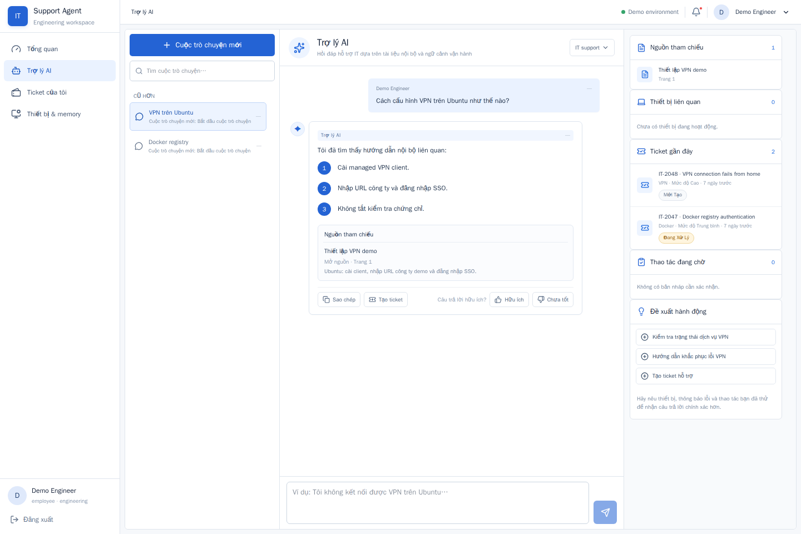
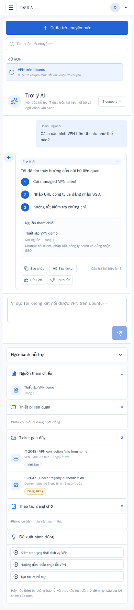
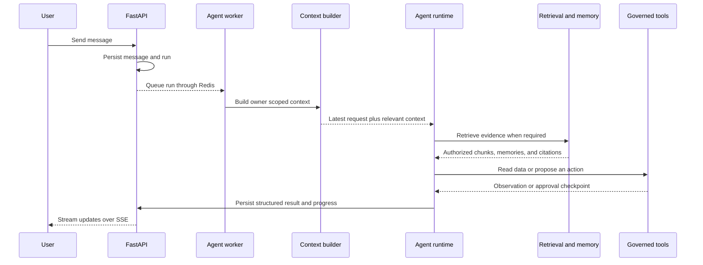
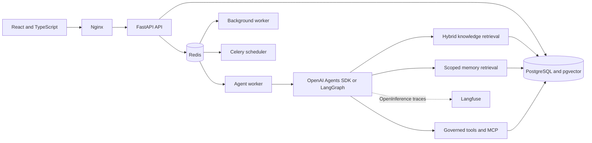
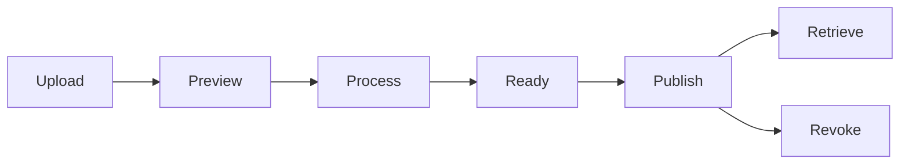

# IT Support Agent Platform

**Stack:** Python 3.12 · Node.js 22 · React · FastAPI · PostgreSQL with pgvector · Redis · Docker Compose<br>
**Quality:** [GitHub Actions CI](https://github.com/trunglap923/IT-Support-Agent-Platform/actions/workflows/ci.yml) · Ruff · mypy · pytest · Vitest · Playwright

A stateful AI support workspace that combines grounded IT guidance, governed actions, scoped memory, and document lifecycle management in one operational product.

[Quick start](#quick-start) · [Architecture](#architecture) · [Evaluation](#evaluation) · [Demo guide](docs/demo-script.md) · [Technical documentation](#documentation)

## Overview

This project explores what an internal IT support agent needs beyond a chat interface:

- answers grounded in published internal documents, with source citations;
- access to operational context such as devices, service status, and tickets;
- approval before actions that create business side effects;
- memory with consent, scope, provenance, and lifecycle controls;
- asynchronous execution with durable run state and recovery;
- evaluation and observability for retrieval, memory, cost, and agent behavior.

The repository contains the complete web application, API, workers, database migrations, deterministic demo data, evaluation harnesses, and local infrastructure.

## Product preview

| Desktop workspace | Mobile workspace |
| --- | --- |
|  |  |

The main workspace keeps the conversation in focus while exposing the sources, device context, ticket history, approvals, and suggested actions needed by a support operator.

## Key capabilities

### Grounded support conversations

- Hybrid retrieval combines dense vectors, BM25, exact terms, metadata signals, and train selected fusion weights.
- Query analysis preserves error codes, versions, products, services, and operating systems.
- Evidence selection applies score thresholds, context budgets, document diversity, and parent or neighboring chunk expansion.
- Citation validation restricts the final answer to sources retrieved during the current run.
- The agent can decline internal guidance when the available evidence is insufficient.

### Agent orchestration and governed tools

- OpenAI Agents SDK is the primary live runtime; LangGraph remains available for deterministic and rollback workflows.
- The runtime selects retrieval, memory, read tools, or approval gated actions from the latest request and scoped context.
- Actor identity, role, and approval state come from trusted application context rather than model arguments.
- Ticket creation uses approval checkpoints, idempotency receipts, and reconciliation after interrupted work.
- Progress events expose observable task steps without storing private chain of thought.

### Memory and context management

- Working memory tracks the active request, constraints, collected observations, and proposed actions.
- Semantic, episodic, and procedural memory have separate contracts and retrieval policies.
- Durable memory is filtered by owner, scope, consent, confidence, authority, and lifecycle state.
- Hybrid memory retrieval combines metadata filters, BM25, vector similarity, exact predicates, recency, and confidence.
- The context builder prioritizes the latest request and distinguishes proposed steps from actions the user confirmed.

### Knowledge governance

- Administrators can upload, preview, process, publish, revoke, and version PDF documents.
- Processing extracts text, creates token aware chunks, generates embeddings, and records source metadata.
- Retrieval rechecks publication state, document version, and access control before returning evidence.
- The ingestion path currently supports text layer PDFs up to 10 MB and 100 pages; scanned documents require an external OCR step.

### Operational product surface

- Role aware employee, IT operator, and administrator workflows.
- Conversation history, run streaming, citations, feedback, and contextual quick actions.
- Ticket queues, service status, device context, approvals, and memory settings.
- Responsive React interface designed for information dense internal operations.

## How a request is handled



The current user message remains the final user turn. Conversation history is selected and summarized separately, which prevents an older topic from silently replacing a new request.

## Architecture



PostgreSQL is the durable source of truth. Redis handles queues, rate limits, and ephemeral coordination. Langfuse provides supplementary tracing and never replaces the application audit trail.

The local Compose stack runs seven services: frontend, API, agent worker, background worker, scheduler, PostgreSQL with pgvector, and Redis. See the [architecture map](docs/architecture.md), [runtime ADR](docs/adr/0002-runtime-and-integration.md), and [Agents SDK ADR](docs/adr/0003-openai-agents-orchestrator.md) for the detailed boundaries.

## Technical highlights

| Area | Implementation |
| --- | --- |
| Frontend | React, TypeScript, Vite, Nginx, responsive product UI |
| API and persistence | FastAPI, async SQLAlchemy, Alembic, PostgreSQL 17, pgvector |
| Asynchronous work | Redis, Celery workers, scheduled reconciliation, SSE updates |
| Agent runtime | OpenAI Agents SDK, structured outputs, LangGraph fallback |
| Retrieval | OpenAI embeddings, BM25, exact matching, weighted reciprocal rank fusion, optional cross encoder experiment |
| Memory | Working, semantic, episodic, and procedural memory with scoped hybrid retrieval |
| Safety and governance | RBAC, ACL filtering, approval checkpoints, idempotency, citation allowlists |
| Observability | Structured logs, request and run IDs, usage ledger, OpenInference, optional Langfuse export |
| Quality | Ruff, mypy, pytest, Vitest, Playwright, public benchmarks, deterministic evals |

## Evaluation

The repository separates deterministic contract tests, public retrieval benchmarks, memory retrieval adaptations, and live model evaluation. Public metrics are linked to their generated reports so that the dataset, split, configuration, and limitations remain reviewable.

### Public retrieval benchmark

The retrieval pipeline was tuned on the SciFact train split and then evaluated on the complete official test split.

| Dataset | Evaluation setup | nDCG@10 | MAP@10 | Recall@5 | Recall@10 | MRR@10 |
| --- | --- | ---: | ---: | ---: | ---: | ---: |
| SciFact | 300 test queries, 5,183 documents, OpenAI `text-embedding-3-small`, BM25 and weighted RRF | 0.7318 | 0.6863 | 0.7897 | 0.8569 | 0.7003 |

The fusion weights were selected using 809 train queries before the held out test run. SciFact measures scientific claim retrieval and does not represent end to end IT support accuracy. Full configuration, ablations, and baseline comparisons are in the [SciFact comparison report](reports/public/scifact/comparison.md).

### Public memory retrieval adaptation

| Dataset | Evaluation setup | nDCG@10 | MAP@10 | Recall@5 | Recall@10 | MRR@10 |
| --- | --- | ---: | ---: | ---: | ---: | ---: |
| LoCoMo | 1,982 session retrieval queries, 272 indexed records, hybrid retrieval with `text-embedding-3-small` | 0.7860 | 0.7278 | 0.8456 | 0.9246 | 0.7605 |

This is a session retrieval adaptation derived from LoCoMo evidence labels and is explicitly marked `paper_comparable: false`. Methodology and per query results are available in the [LoCoMo report](reports/public/memory/locomo/retrieval-openai.md).

### Reproduce evaluations

```bash
make eval                               # deterministic agent and contract evaluation
make retrieval-baseline                 # isolated internal retrieval baseline
make public-retrieval-smoke              # 10-query SciFact integration check
make public-retrieval-benchmark          # complete SciFact test split
make public-memory-smoke                 # fixed LoCoMo and LongMemEval sample
make public-memory-locomo-openai         # paid OpenAI embedding run
```

Paid benchmark targets require an API key and an explicit opt in flag. See [infra/commands.md](infra/commands.md) for their data boundaries and configuration.

## Quick start

### Prerequisites

- Docker Engine with the Compose plugin
- GNU Make

Python and Node.js are not required on the host for the Docker workflow.

### Start the demo

```bash
cp .env.example .env
```

Set local values in `.env` before seeding:

```dotenv
POSTGRES_PASSWORD=replace-with-a-local-database-password
DEMO_SEED_PASSWORD=replace-with-at-least-12-characters
```

Build the images, migrate the database, seed the demo scenarios, and start the stack:

```bash
make bootstrap
make demo
```

Open [http://127.0.0.1:5173](http://127.0.0.1:5173). Check API readiness at [http://127.0.0.1:8000/api/v1/health/ready](http://127.0.0.1:8000/api/v1/health/ready).

Useful lifecycle commands:

```bash
make status
make logs-agent
make down       # stop containers and preserve named volumes
```

### Demo accounts

All seeded accounts use `DEMO_SEED_PASSWORD` from `.env`.

| Email | Role | Department |
| --- | --- | --- |
| employee.engineering@example.com | Employee | Engineering |
| employee.operations@example.com | Employee | Operations |
| it.engineering@example.com | IT operator | Engineering |
| it.operations@example.com | IT operator | Operations |
| admin@example.com | Administrator | Operations |

The seed is idempotent and includes users, devices, service states, tickets, approvals, and a small published knowledge corpus. Run `make seed-dry-run` to preview changes without writing them.

## Runtime modes

The default configuration is deterministic and does not call paid APIs:

```dotenv
TEXT_PROVIDER=fake
EMBEDDING_PROVIDER=fake
AGENT_RUNTIME=auto
```

To run the product with OpenAI generation and embeddings:

```dotenv
TEXT_PROVIDER=openai
EMBEDDING_PROVIDER=openai
AGENT_RUNTIME=openai_agents
OPENAI_API_KEY=your-key
```

Restart the stack after changing runtime configuration:

```bash
make up
```

The application applies daily and monthly usage budgets from `.env`. Provider billing should still be monitored independently.

## Knowledge document lifecycle



Only published document versions are eligible for production retrieval. Processing is intentionally explicit so an administrator can inspect extracted text before generating chunks and embeddings. Document access rules are enforced during ingestion and checked again when evidence is selected.

The administration flow is available at `/admin/documents`. For ingestion failures and tracing guidance, see [troubleshooting](docs/troubleshooting.md).

## Observability with Langfuse

Langfuse integration is optional. Configure a project in `.env`:

```dotenv
LANGFUSE_PUBLIC_KEY=pk-lf-...
LANGFUSE_SECRET_KEY=sk-lf-...
LANGFUSE_BASE_URL=https://cloud.langfuse.com
LANGFUSE_CAPTURE_CONTENT=false
```

Each agent run creates a root observation with nested agent, model, and tool spans. Run IDs and pseudonymous actor or session identifiers make traces correlatable with application logs. Prompt and output content is redacted by default; the related OpenInference controls are documented in `.env.example`.

Langfuse is used for diagnostics, latency, token usage, and cost analysis. PostgreSQL remains the audit source for runs, approvals, and tool receipts.

## Development and quality checks

Install locked host dependencies when developing outside the containers:

```bash
make bootstrap-host
make services-up
make migrate
```

Run the API and frontend in separate terminals:

```bash
make dev-backend
make dev-frontend
```

Primary quality commands:

```bash
make check          # backend and frontend static checks and tests
make test           # isolated backend services plus frontend checks
make test-e2e       # browser workflows in pinned Playwright
make eval           # deterministic evaluation suite
make clean-verify   # clean Compose build, migration, seed, and readiness
make docs-check     # validate relative Markdown links
```

The test and evaluation commands use isolated Compose projects or temporary databases and do not reset the development database. The CI workflow runs the repository checks on every pushed change.

## Repository structure

```text
backend/        FastAPI application, agent runtimes, retrieval, memory, and workers
frontend/       React application and browser tests
data/           Versioned demo knowledge corpus and metadata
evals/          Evaluation contracts, datasets, runners, and public benchmark adapters
infra/          Compose files, Nginx, backup scripts, and operational commands
docs/           Architecture, ADRs, runbooks, contracts, and implementation notes
reports/        Generated evaluation evidence and release quality reports
```

## Documentation

| Document | Purpose |
| --- | --- |
| [Architecture](docs/architecture.md) | Components, data flows, trust boundaries, and deployment topology |
| [Memory and context architecture](docs/memory-context-architecture.md) | Working and durable memory contracts, lifecycle, and retrieval |
| [Runtime ADR](docs/adr/0002-runtime-and-integration.md) | Runtime selection and integration decisions |
| [OpenAI Agents SDK ADR](docs/adr/0003-openai-agents-orchestrator.md) | Primary orchestrator decision and fallback strategy |
| [Demo script](docs/demo-script.md) | Guided product walkthrough and expected behavior |
| [Command reference](infra/commands.md) | Reproducible commands, environment boundaries, and paid opt ins |
| [Backup and restore](infra/backup-and-restore.md) | PostgreSQL and document storage recovery drill |
| [Troubleshooting](docs/troubleshooting.md) | Common local, ingestion, worker, and tracing issues |
| [Evaluation summary](reports/evaluation-summary.md) | Evaluation suites, results, and interpretation |
| [Release checklist](reports/release-checklist.md) | Current quality gates and unresolved release evidence |

## Project status and limitations

The repository is suitable for local demonstration, architecture review, and continued evaluation. It should not be treated as a production ready IT service without deployment specific security review and operational evidence.

Current limitations include:

- live model quality, latency, and cost depend on the configured provider and require environment specific evaluation;
- public retrieval metrics validate retrieval components, not complete IT support answer accuracy;
- PDF ingestion requires a text layer and does not include OCR;
- human review, load, resilience, accessibility, and production incident drills remain deployment gates;
- the bundled service status and business data are deterministic demo scenarios.

The [release checklist](reports/release-checklist.md) is the source of truth for completed and outstanding quality gates.
