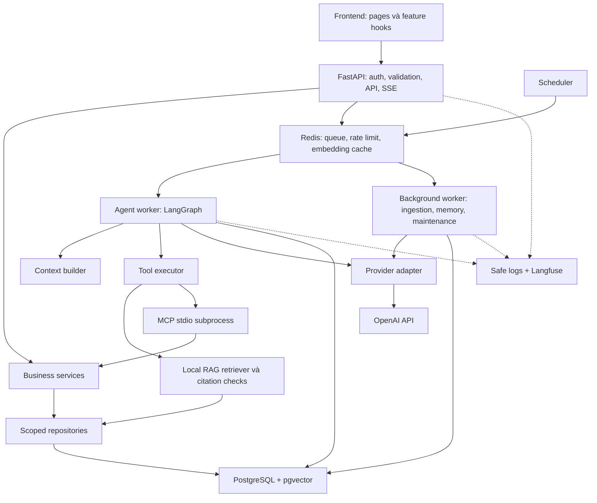

# Bản đồ kiến trúc và trách nhiệm

Trạng thái: thiết kế đích; mới khởi tạo thư mục và kế hoạch, chưa có tiến trình chạy.

Nguồn yêu cầu: [kế hoạch tổng, mục 5](../plan.md). Thứ tự viết code: [roadmap](implementation-roadmap.md).

## Các đường chính

Sơ đồ cho thấy luồng gọi chính, không phải lời cam kết mọi thao tác chạy trong một transaction. DB transaction phải ngắn; không giữ transaction qua model call hoặc lúc chờ người dùng xác nhận.

## Ranh giới module

| Module | Sở hữu | Không làm |
|---|---|---|
| [api](../backend/app/api/PLAN.md) + [auth](../backend/app/auth/PLAN.md) | HTTP, session/CSRF, actor context, SSE có scope | Nhét prompt/vector query trong router |
| [services](../backend/app/services/PLAN.md) | Quyền nghiệp vụ, transitions, approval, receipt và transaction | Tin role/owner do model tự gửi |
| [repositories](../backend/app/repositories/PLAN.md) + [db](../backend/app/db/PLAN.md) | Scoped queries, models, constraints, sessions | Bỏ ownership vì caller là admin/worker |
| [agent](../backend/app/agent/PLAN.md) + [context](../backend/app/agent/context/PLAN.md) | Graph, state, bounded execution, checkpoint/context | Ghi ticket trực tiếp hoặc chứa HTTP logic |
| [RAG](../backend/app/rag/PLAN.md) | Ingest/chunk/retrieve, nguồn và ACL hiện hành | Tự publish draft chưa ready hoặc tự crawl URL |
| [tools](../backend/app/tools/PLAN.md) | Schema model-visible, validation và dispatch | Cho model quyết định actor/approval |
| [mcp_server](../backend/app/mcp_server/PLAN.md) | Adapter của ba business tools qua stdio | Public endpoint hoặc server có OpenAI key kế thừa |
| [memory](../backend/app/memory/PLAN.md) | Consent, facts/device, incident references, epoch | Tự nhớ toàn bộ lịch sử hoặc lấy dữ liệu chéo user |
| [providers](../backend/app/providers/PLAN.md) | Generate/embed, typed output, usage, fake mode | Thực hiện tool side effects |
| [jobs](../backend/app/jobs/PLAN.md) | Queues, claim/lease, retry/reconcile, cleanup | Coi Redis delivery là exactly-once |
| [observability](../backend/app/observability/PLAN.md) | Trace/log/usage được lọc | Coi Langfuse là nguồn audit nghiệp vụ duy nhất |
| [frontend](../frontend/PLAN.md) | Pages, preview, trạng thái và nguồn | Tự suy thành công từ câu trả lời model |

Chiều phụ thuộc code chủ đạo: entrypoint → service/orchestration → repository/provider. Repository không import router; provider không import graph; MCP dùng chung service thay vì chép nghiệp vụ. Các dependency được truyền vào ở composition root của [app](../backend/app/PLAN.md).

## Ba điểm cần giữ khi viết code

1. Ticket: model/form tạo draft → lưu approval và pause → người dùng quyết định → worker resume bằng quyết định từ DB → executor/MCP → transaction tạo ticket + receipt + audit. Retry kiểm tra receipt để không tạo trùng.
2. Knowledge: upload → draft version → ingestion ready → admin publish → retrieval chỉ lấy version hiện hành đúng scope. Final answer, lịch sử và source download đều kiểm tra lại quyền.
3. Memory: tắt mặc định → user đồng ý → fact pending → user xác nhận → context mới mới được dùng. Tắt/xóa làm job epoch cũ không được ghi lại.

## Runtime và dữ liệu

Compose dự kiến có bảy service theo [infra](../infra/PLAN.md). API, workers và MCP chia entrypoint nhưng cùng package/image Python; không tách thêm microservice. Document files ở volume runtime, khác [corpus nguồn trong data](../data/PLAN.md).

PostgreSQL là nguồn trạng thái run/job/ticket/approval/memory; Redis là broker/cache/rate limit. Langfuse Cloud và OpenAI là phụ thuộc ngoài; fake mode phục vụ test offline với model, không thay thế live evaluation.

Thay đổi ảnh hưởng các ranh giới này cần [ADR](adr/PLAN.md) và cập nhật kế hoạch module tương ứng.
