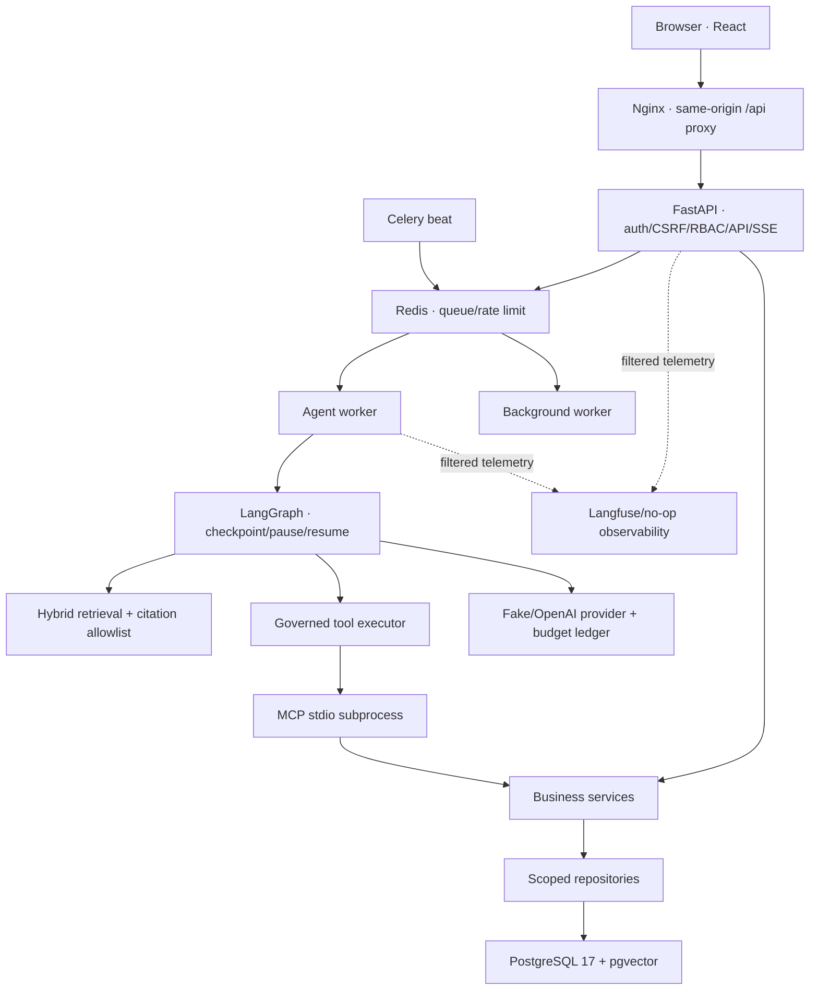

# Kiến trúc hệ thống

Trạng thái: kiến trúc V1 đã được triển khai local; production operation và live quality gates còn ngoài phạm vi bằng chứng hiện tại.

## Runtime topology

Compose có đúng bảy long-running service: frontend, API, agent worker, background worker, scheduler, PostgreSQL và Redis. API/workers dùng cùng production image Python; MCP là subprocess stdio nội bộ, không có public port. Chỉ frontend/API bind vào loopback; datastore nằm trên internal network.

## Ranh giới tin cậy

| Lớp | Trách nhiệm | Ràng buộc |
|---|---|---|
| API/auth | Session cookie, CSRF, actor, owner/role checks, SSE cursor | Không nhận actor/role từ model hoặc request payload |
| Services | State transition, approval, ticket receipt, document/memory lifecycle | Transaction ngắn; không giữ DB transaction qua model call/approval wait |
| Repository/DB | Scoped query, FK/unique/check constraints, durable events | PostgreSQL là nguồn sự thật |
| LangGraph | Bounded graph, RAG flow, checkpoint, interrupt/resume | Không ghi ticket trực tiếp |
| Tools/MCP | Strict schemas, allowlist, trusted actor/run context | MCP read tools chỉ đọc status và ticket của actor |
| Provider | Structured generation/embedding, token/cost ledger | Không sở hữu side effect; paid call phải qua budget guard |
| Jobs | Queue, lease, heartbeat, retry/reconcile | Redis delivery không được coi exactly-once |
| Frontend | Hiển thị server state, citation, approval và errors | Không tự suy side effect thành công từ model text |

## Ba workflow quan trọng

### Chat/RAG

Message và run được commit trước khi enqueue. Worker claim run, dựng owner/device/memory context, rewrite/retrieve trong scope, chọn no-answer hoặc generate structured answer. Citation cuối chỉ được tạo từ result IDs do retrieval trả về. SSE reconnect dùng event cursor và không tạo run mới.

### Approval/ticket

Model hoặc form chỉ tạo approval draft. LangGraph pause; user đúng owner approve/reject trong thời hạn. Resume kiểm tra checkpoint, argument hash và actor. Ticket transaction ghi unique approval receipt nên double-click/retry/crash sau commit vẫn quy về đúng một ticket.

### Document/memory

PDF upload có MIME/size/path guard, tạo draft version, parse/chunk/embed/store idempotent rồi admin publish. Retrieval/history recheck current version và ACL. Memory mặc định tắt; extraction chỉ tạo candidate, user phải confirm. Device scope, optimistic version và epoch ngăn job cũ ghi lại fact sau delete/disable.

## Dữ liệu và durability

- PostgreSQL: identity/session, conversation/run/event, checkpoint, documents/chunks/ACL, approvals/tickets, memory và usage ledger.
- Redis: Celery broker/result plumbing, login rate-limit và lease-related runtime data; AOF `everysec`, `noeviction`.
- Document volume: PDF do ứng dụng quản lý bằng server-owned storage key.
- Backup: PostgreSQL custom dump + document archive + integrity manifest; Redis không nằm trong backup vì durable business state ở PostgreSQL.

## Trade-offs và giới hạn

- Single-company prototype, không có tenant boundary hoàn chỉnh.
- Exact vector scan/full-text phù hợp corpus demo; HNSW/reranker chỉ thêm khi số đo yêu cầu.
- Local files phù hợp demo; production cần object storage, encryption và remote retention.
- Fake provider đảm bảo test deterministic nhưng không đại diện chất lượng model. G-05–G-09 chưa đủ live/human/full-stack evidence.
- Langfuse là observability phụ trợ, không phải audit source of truth.
- Deployment server, TLS, secrets manager, autoscaling và production monitoring chưa thuộc repository này.

Các thay đổi ranh giới nền tảng cần ADR. Quyết định/runtime versions nằm tại [ADR-0002](adr/0002-runtime-and-integration.md); hướng vận hành ở [infra commands](../infra/commands.md).
