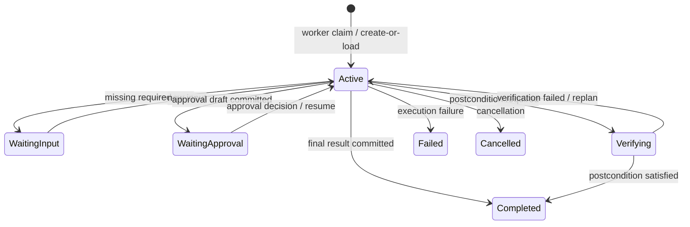

# Durable Working Memory — Phase 1

Phase 1 adds application-owned task state around both the OpenAI Agents SDK and LangGraph runtime
paths. It records observable goals, plan steps, tool outcomes, pending approvals, verification
requirements and counters. It does not store hidden chain-of-thought.

## Storage

Migration `0021_durable_working_memory` creates:

- `working_memory_snapshots`: one current, versioned snapshot per agent run;
- `working_memory_events`: append-only lifecycle and observation events with an operation ID;
- `tool_observations`: owner-scoped normalized tool results, hashes and receipt references.

Snapshot updates and their events commit in one database transaction. The service locks the current
row, checks an optional expected version, increments the snapshot version and allocates the next
event sequence. Operation IDs and tool call IDs make retries idempotent.

## Runtime lifecycle



The worker creates or loads the snapshot in the same transaction as the run claim. Tool wrappers
persist a normalized observation before the next reasoning step. Final result, approval pause and
failure transitions update the run and working memory in the same transaction. Both SDK-native and
legacy approval resume paths reconcile pending actions before completing the run.
User cancellation and approval expiry also close pending working-memory actions atomically with the
run transition.

## Tool data boundary

`normalize_tool_result()` stores:

- canonical argument and result hashes;
- status and allowlisted error code;
- a bounded summary with per-tool safe metadata;
- a ticket receipt reference when a ticket was created.

It does not copy raw arguments, knowledge excerpts, profile names, ticket titles or service messages
into `tool_observations`. The original owner-scoped business record remains the authoritative source.

## Operations

Apply the migration before starting workers:

```bash
make migrate
```

Regenerate the contract schemas after changing the Pydantic contracts:

```bash
make export-memory-context-contracts
```

## Phase boundary

Working memory is currently durable shadow state. Phase 2 will build bounded active context from it
and use the same context policy for both runtimes. No public API or frontend contract changes in this
phase.
